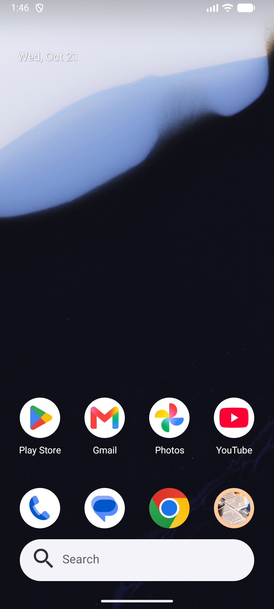
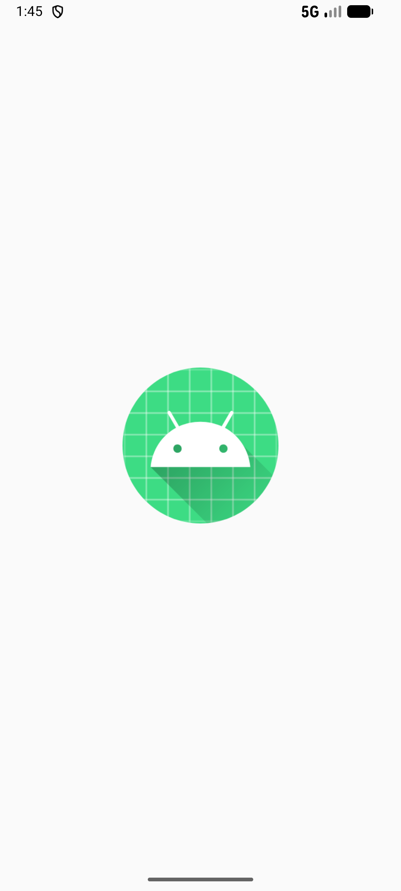
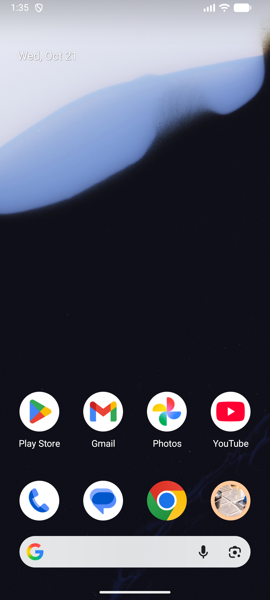

# DateMark 🗓️

An elegant, modern, and privacy-focused Android application for marking, tracking, and calculating days remaining or passed for important dates, milestones, anniversaries, and countdowns. Built natively with **Kotlin** and **Jetpack Compose**.

---

## 🌟 Overview

**DateMark** helps you keep track of what matters most—from upcoming events and birthdays to project deadlines and personal milestones. It provides exact day calculations, flexible sorting, yearly recurrence support (including leap years), and automatic local midnight updating.

---

## 🚀 Key Features

- 📌 **Mark & Track Dates**: Easily add labels, target dates, custom descriptions, and optional yearly recurrence to important events.
- ⏱️ **Exact Day Calculations**: Instantly displays precise remaining days (Upcoming), days passed (Past), or status for dates occurring Today.
- 🔄 **Yearly Recurrence Support**: Automatically calculates next occurrence for annual events, seamlessly handling leap year dates like February 29th.
- 🌙 **Automatic Midnight Recalculation**: System broadcast listeners dynamically refresh date calculations at local midnight or when device time settings change.
- 🔍 **Instant Search & Filtering**: Fast, case-insensitive keyword search with filter tabs (`All`, `Upcoming`, `Past`).
- ↕️ **Smart Sorting Modes**: Sort list by **Nearest First**, **Furthest First**, or **Alphabetical (A–Z)**.
- 🎨 **Material Design 3 & Dark Theme**: Built with Jetpack Compose Material 3, supporting system dark mode, customizable app themes, and Material You Dynamic Color.
- 📋 **One-Tap Share & Copy**: Quickly copy event details or share countdowns with friends and family.
- 🔒 **100% Offline & Private**: Zero cloud sync, no tracking, no external account requirement, and no unnecessary permissions. All data remains exclusively on your device.

---

## 📱 Screenshots

| Home Dashboard | Live Countdown & Detail | Date Management |
| :---: | :---: | :---: |
|  |  |  |

---

## 🛠️ Tech Stack & Architecture

- **Language:** [Kotlin](https://kotlinlang.org/)
- **UI Toolkit:** [Jetpack Compose](https://developer.android.com/jetpack/compose) with Material Design 3
- **Architecture Pattern:** MVVM (Model-View-ViewModel) + Repository Pattern
- **State Management:** Kotlin `StateFlow` & `Coroutines`
- **Navigation:** Jetpack Navigation Compose
- **Date/Time Engine:** `java.time` API (LocalDate, ChronoUnit)
- **Local Persistence:** SharedPreferences with JSON serialization
- **Testing:** JUnit 4 unit test suite covering date calculators, recurrence logic, filter/sorter, and persistence.

---

## 📂 Project Structure

```text
com.example.datemark
├── data          # Repositories for saved dates and app settings
├── domain        # Pure Kotlin calculators, filter/sorters, formatters & validators
├── model         # Data models (DateMark, AppSettings, Recurrence, DateStatus)
├── navigation    # NavHost graph and destination routes
├── ui
│   ├── components # Reusable UI composables (DateCard, DateBadge, BottomBar, etc.)
│   ├── screens    # App screens (Home, Add/Edit, Detail, Settings, About, Splash)
│   └── theme      # Material 3 colors, typography, and theme definitions
└── DateMarkViewModel.kt # Main ViewModel managing unified UI state
```

---

## ⚙️ Building & Running

### Prerequisites
- **Android Studio** (Ladybug or newer recommended)
- **JDK 17** or higher
- **Android SDK** Min SDK 26 (Android 8.0) / Target SDK 35 (Android 15)

### Steps
1. Clone the repository:
   ```bash
   git clone https://github.com/abdullah-ateeq/DateMark.git
   cd DateMark
   ```
2. Open the project in Android Studio.
3. Build the debug APK using Gradle:
   ```bash
   ./gradlew assembleDebug
   ```
4. Run Unit Tests:
   ```bash
   ./gradlew test
   ```

---

## 🤝 Contributing

Contributions, issues, and feature requests are welcome! Feel free to check out the [issues page](https://github.com/abdullah-ateeq/DateMark/issues).

---

## 📄 License

This project is open source and available under the [MIT License](LICENSE).
